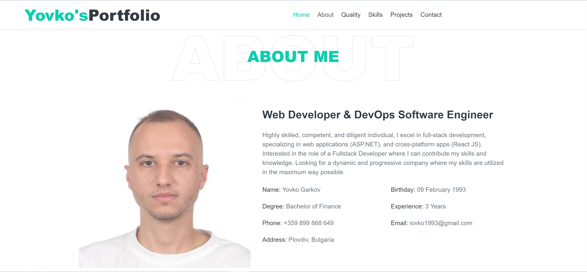

<div align="center">

# Yovko's Portfolio

**A personal portfolio built with C#, Blazor WebAssembly, and .NET 8.**

Professional experience, technical skills, and selected projects in one responsive website.

[View Portfolio](https://yovko-portfolio.onrender.com) · [Quickstart](#quickstart) · [Report an Issue](https://github.com/yovko93/my-portfolio/issues)

[](https://github.com/yovko93/my-portfolio/actions/workflows/docker-publish.yml)
[](https://github.com/yovko93/my-portfolio/actions/workflows/codeql.yml)
[](MyPortfolioApp/MyPortfolioApp.csproj)
[](MyPortfolioApp/Program.cs)
[](LICENSE.md)

</div>

## Table of Contents

- [About](#about)
- [Preview](#preview)
- [Features](#features)
- [Technology Stack](#technology-stack)
- [Quickstart](#quickstart)
- [Run with Docker](#run-with-docker)
- [Customization](#customization)
- [Project Structure](#project-structure)
- [Build and Deployment](#build-and-deployment)
- [Contributing](#contributing)
- [License](#license)
- [Contact](#contact)

## About

This repository contains the source code for **Yovko Garkov's personal portfolio**. It introduces his background in software development, presents his education and experience, and showcases selected work alongside the technologies used.

The application runs in the browser using Blazor WebAssembly. Profile information and project entries load from local JSON files, while Razor components define the page sections. The published site consists of static assets, with Docker and Nginx providing the included hosting setup. No database or application backend is required to run the portfolio; contact form submissions use an external service.

## Preview

[](https://yovko-portfolio.onrender.com)

*Repository screenshot of the portfolio's About Me section.*

## Features

- **Personal introduction** with an animated role headline and a link to a PDF résumé.
- **About Me section** with a biography, profile photo, and contact details loaded from JSON.
- **Education and experience** presented in a timeline layout.
- **Technical skills gallery** with technology and tooling icons.
- **Project carousel** with screenshots, descriptions, and technology stacks.
- **Contact form** integrated with FormSubmit, plus a dedicated thank-you page.
- **Responsive navigation** with smooth scrolling and a back-to-top control.
- **Container deployment** with a multi-stage Docker build, Nginx hosting, and GitHub Actions workflows.

## Technology Stack

| Area | Technologies |
| --- | --- |
| Application | .NET 8, C#, Blazor WebAssembly, Razor components |
| Styling | HTML, CSS, Bootstrap 4, Font Awesome |
| Browser interactions | JavaScript interop, jQuery, Typed.js, Owl Carousel |
| Content | Static JSON files served from `wwwroot/sample-data` |
| Contact form | FormSubmit |
| Hosting | Docker, Nginx, Render |
| Automation | GitHub Actions for build, image publishing, deployment, and CodeQL analysis |

## Quickstart

### Prerequisites

- [.NET 8 SDK](https://dotnet.microsoft.com/en-us/download/dotnet/8.0).
- [Git](https://git-scm.com/downloads).
- A modern browser with WebAssembly support.

### Clone and run

```shell
git clone https://github.com/yovko93/my-portfolio.git
cd my-portfolio
dotnet restore MyPortfolio.sln
dotnet run --project MyPortfolioApp/MyPortfolioApp.csproj --launch-profile http
```

Open [http://localhost:5244](http://localhost:5244) in your browser. Stop the development server with `Ctrl+C`.

The HTTP profile and port are defined in [launchSettings.json](MyPortfolioApp/Properties/launchSettings.json). Internet access is needed to restore NuGet packages and load the site's external scripts, styles, and contact service.

### Develop with automatic reload

Run this command from the repository root:

```shell
dotnet watch --project MyPortfolioApp/MyPortfolioApp.csproj run --launch-profile http
```

## Run with Docker

With Docker installed and running, execute these commands from the repository root:

```shell
docker build -t my-portfolio ./MyPortfolioApp
docker run --rm -p 8080:8080 --name my-portfolio my-portfolio
```

Open [http://localhost:8080](http://localhost:8080). Stop the container with `Ctrl+C`; `--rm` removes it after it stops.

The [Dockerfile](MyPortfolioApp/Dockerfile) publishes the application with the .NET 8 SDK and copies the static output into an Nginx image. Both Nginx and the container use port `8080`. The build context must be `./MyPortfolioApp`, as shown above.

## Customization

### Profile and project content

Edit the following files to update the portfolio:

| Content | File |
| --- | --- |
| Biography and personal details | [`aboutme.json`](MyPortfolioApp/wwwroot/sample-data/aboutme.json) |
| Footer name, email, and social handles | [`siteproperties.json`](MyPortfolioApp/wwwroot/sample-data/siteproperties.json) |
| Project descriptions, screenshots, and technology icons | [`projects.json`](MyPortfolioApp/wwwroot/sample-data/projects.json) |
| About Me photo mapping | [`heroimages.json`](MyPortfolioApp/wwwroot/sample-data/heroimages.json) |
| Hero name, photo, and résumé link | [`Home.razor`](MyPortfolioApp/Components/Home.razor) |
| Animated role titles | [`typedInterop.js`](MyPortfolioApp/wwwroot/js/typedInterop.js) |
| Education and employment history | [`Quality.razor`](MyPortfolioApp/Components/Quality.razor) |
| Visible skills gallery | [`Skills.razor`](MyPortfolioApp/Components/Skills.razor) |
| Navigation branding and footer text | [`Header.razor`](MyPortfolioApp/Shared/Header.razor), [`Footer.razor`](MyPortfolioApp/Shared/Footer.razor) |
| Browser title and favicon | [`index.html`](MyPortfolioApp/wwwroot/index.html) |
| Site appearance | [`style.css`](MyPortfolioApp/wwwroot/css/style.css) |

Images live in [`wwwroot/images`](MyPortfolioApp/wwwroot/images), and the résumé is [`wwwroot/files/Resume.pdf`](MyPortfolioApp/wwwroot/files/Resume.pdf). Image paths in JSON are relative to `wwwroot`, for example `images/projects/my-portfolio-web.png`.

The visible skills gallery and education timeline are authored directly in Razor components. Updating `skills.json` alone does not change the gallery.

### Contact form and site address

When adapting the portfolio for your own use:

1. Replace the form `action` in [`Contact.razor`](MyPortfolioApp/Components/Contact.razor) with your own FormSubmit endpoint.
2. Change the hidden `_next` field to your deployed site's `/thank-you` URL.
3. Update the return link in [`ThankYou.razor`](MyPortfolioApp/Pages/ThankYou.razor).
4. Update `server_name` in [`default.conf`](MyPortfolioApp/default.conf) for your hosting domain.

The included contact form points to the original portfolio's recipient and production redirect. Configure your own endpoint before sending a test message.

## Project Structure

```text
my-portfolio/
|-- .github/workflows/           # Docker publishing, deployment, and CodeQL
|-- MyPortfolioApp/
|   |-- Components/              # Home, About, Quality, Skills, Projects, Contact
|   |-- Models/                  # Profile, project, image, and site data models
|   |-- Pages/                   # Main page and thank-you route
|   |-- Properties/              # Local launch profiles
|   |-- Services/                # JSON-backed image and project services
|   |-- Shared/                  # Layout, header, and footer
|   |-- wwwroot/
|   |   |-- css/                 # Stylesheets
|   |   |-- files/               # PDF resume
|   |   |-- images/              # Profile photos, project images, and icons
|   |   |-- js/                  # JavaScript interop and scrolling behavior
|   |   |-- lib/                 # Bundled browser libraries
|   |   |-- sample-data/         # Portfolio JSON content
|   |   `-- index.html           # Browser entry point
|   |-- Dockerfile              # .NET publish and Nginx runtime stages
|   |-- default.conf            # Nginx port and client-side routing fallback
|   |-- MyPortfolioApp.csproj
|   `-- Program.cs              # Blazor startup and service registration
|-- LICENSE.md
|-- MyPortfolio.sln
`-- README.md
```

## Build and Deployment

### Build locally

```shell
dotnet build MyPortfolio.sln --configuration Release
dotnet publish MyPortfolioApp/MyPortfolioApp.csproj --configuration Release --output ./artifacts/publish
```

The deployable static site is generated in `artifacts/publish/wwwroot`. Serve that directory through a static web host with a fallback to `index.html` for client-side routes such as `/thank-you`. The included Nginx configuration provides this fallback.

### GitHub Actions

The [build and deployment workflow](.github/workflows/docker-publish.yml) runs on pushes to `master` and supports manual execution. It builds and publishes `yovko93/my-portfolio-app:latest` to Docker Hub, then calls a Render deployment hook when running on `master`.

For deployment from your own fork, update the Docker image name in the workflow and configure these repository secrets:

| Secret | Purpose |
| --- | --- |
| `DOCKER_HUB_USERNAME` | Docker Hub account used to publish the image |
| `DOCKER_HUB_PASSWORD` | Docker Hub credential or access token used by the workflow |
| `RENDER_DEPLOY_HOOK_URL` | Deployment hook for the target Render service |

The [CodeQL workflow](.github/workflows/codeql.yml) configures C# analysis on pushes to `master` and on pull requests. The badges at the top link to the current workflow results.

## Contributing

Suggestions, bug reports, and improvements are welcome. [Open an issue](https://github.com/yovko93/my-portfolio/issues) to describe a problem or propose a change.

To contribute code, fork the repository, create a branch, and submit a pull request with a clear description. Before submitting, run a Release build and check the affected sections in the browser at desktop and mobile widths. For changes to navigation or hosting, also check the `/thank-you` route.

## License

This project is licensed under the [MIT License](LICENSE.md). Bundled third-party libraries remain subject to their respective licenses.

## Contact

**Yovko Garkov**

- [Portfolio](https://yovko-portfolio.onrender.com)
- [GitHub](https://github.com/yovko93)
- [LinkedIn](https://www.linkedin.com/in/yovko-garkov/)
- [Email](mailto:iovko1993@gmail.com)

[Back to top](#yovkos-portfolio)

